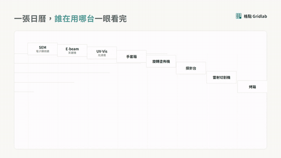
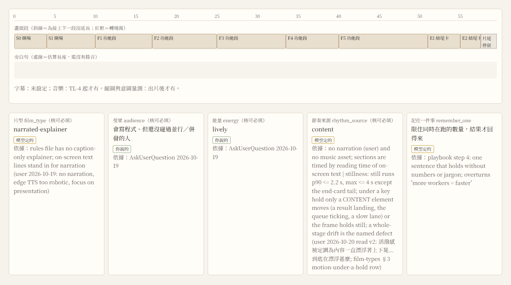
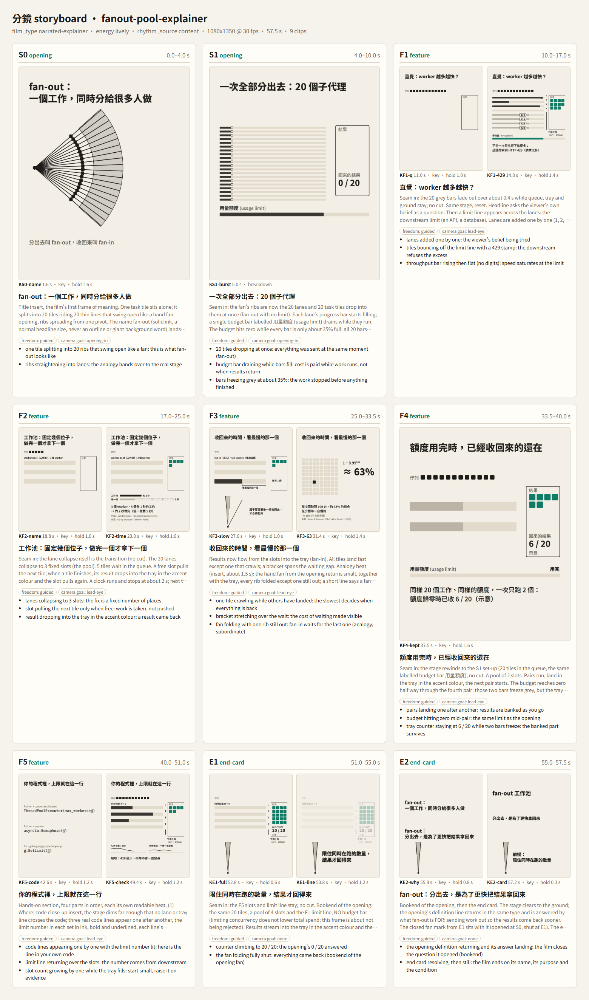
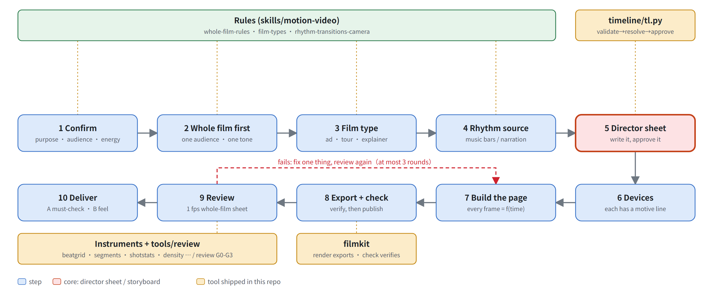
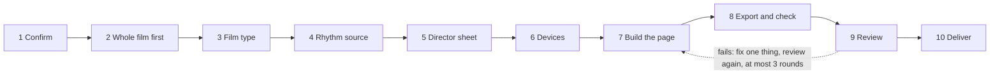

<div align="center">

# motion-video-kit

**Make a whole video with code: write one director sheet that fixes the audience, tone, sections, transitions and camera first, then compute every frame, export an MP4, and measure whether the film followed the sheet.**

A Claude Code skill (motion-video, with five method documents) + the director-sheet tool (timeline: validate, resolve times, approve) + render-and-check tools (filmkit) + a review loop (review) + an edit route (edit) + 27 measuring instruments that each carry a self-test + one complete worked example film.

[繁體中文](README.md) · **English**

[](https://github.com/WizerdBaChe/motion-video-kit/releases/latest)
[](LICENSE)
[](LICENSE-DOCS)
[](AGENTS.md)
[](docs/DEVELOPER.md)
[](docs/DEVELOPER.md)

[Showcase](#what-it-makes) · [The core: director sheet](#the-core-the-director-sheet-storyboard) · [Use it](#use-it) · [Limits](#limits) · [Developer docs](docs/DEVELOPER.md) · [Agent entry](AGENTS.md) · [Changelog](CHANGELOG.md)


<sub>An excerpt of a hype ad rendered with this repo's method and tools (animation; the full MP4 is a release asset).</sub>

</div>

## What it solves

Ask an AI for a video and the usual bad outcomes are:

- **It starts drawing at once.** Nobody asked who watches, what they should do afterwards, or how hot the tone is: every section is flashy and the whole has no point.
- **"Does this section flow" is a feeling.** Where a section change sits against the beat, whether narration and picture line up, whether the camera moves: nobody measures; you learn it is wrong only after watching.
- **Each revision forgets the last.** Round two quietly reverts what round one settled.

This kit separates thinking from making and leaves a checkable record at every step:

| Stage | What you get | What guards it |
|---|---|---|
| **Confirm first** | purpose, film type, where it plays, audience, the one thing to remember, energy (calm / lively / hype) | the skill requires these to be asked and written first; with nobody to ask they go to `questions.md`, never guessed |
| **Director sheet** (the core) | one `film.timeline.json`: per section start, duration, freedom, motion intent, key frames | `tl.py` validates format and timing, resolves to seconds, and a sheet is approved before any page is built |
| **Build and export** | a page whose every frame is a pure function of time; filmkit captures frame by frame, encodes, verifies, and publishes the file name only if it passes | `tools/filmkit/check.py` gives a five-line verdict and rule rows (FK-R) on the file |
| **Measure and review** | 27 instruments (beat alignment, narration lock, camera, motion density, product-claim truth...); four review gates G0-G3, at most 3 rounds | every instrument has `--selftest` (synthetic known-true and known-false inputs); the review loop's refusal rules have self-tests |

## What it makes

Each clip below is an excerpt of a complete film made with this method and these tools, grouped by use. The animations are reduced; full MP4s are on the [release page](https://github.com/WizerdBaChe/motion-video-kit/releases/latest). (On-screen text is mostly Traditional Chinese; products and companies in the films are fictional or the author's own work; no real people, no third-party trademarks.)

<table>
<tr>
<td width="50%" valign="top">

**Hype ad: beat cuts, camera push-ins**<br>
<sub>A 30-second ad for a download tool: headline type, progress and page cards change on the beat. Full MP4: release asset <code>showcase-hype-ad.mp4</code></sub>


</td>
<td width="50%" valign="top">

**Product intro: one feature, one screen**<br>
<sub>A section of a product intro: each screen says one thing, and the transition carries the previous screen's shape into the next. Full MP4: <code>showcase-product-intro.mp4</code></sub>



</td>
</tr>
<tr>
<td width="50%" valign="top">

**Narrated explainer: explaining fan-out concurrency in pictures**<br>
<sub>The worked example fanout-pool-explainer (its page ships here, so you can re-render it). Full MP4: <code>showcase-narrated-explainer.mp4</code></sub>


</td>
<td width="50%" valign="top">

**WebGL 3D scene**<br>
<sub>A 3D scene built in the page with Three.js; every frame is still computed from time, so it exports frame by frame. Full MP4: <code>showcase-webgl-scene.mp4</code></sub>


</td>
</tr>
<tr>
<td colspan="2" valign="top">

**Text motion: one line, different motion vocabularies**<br>
<sub>Each motion name is implemented and described, to check that the name matches what was made. Full MP4: <code>showcase-text-motion.mp4</code></sub>


</td>
</tr>
</table>

<sub>The animations are cut from the full MP4s by <code>docs/assets/build_showcase.py</code> (commands in the <a href="docs/DEVELOPER.md">developer docs</a>). The explainer can be re-rendered from the page and filmkit shipped here; the page sources of the other four are not in this repo, only the finished films. Audio is removed from the published hype-ad and product-intro MP4s.</sub>

## The core: the director sheet (storyboard)

The core of the method is not the renderer and not the instruments. It is the **director sheet**: the table written and approved before any building starts.



<sub>A real view page produced by this repo's <code>tl.py</code> from the shipped example film. Labels in the picture are Traditional Chinese.</sub>

What each section of the sheet says is the film's contract:



<sub>Built by <code>docs/assets/build_core.py</code>, which renders the key frames of the example film and composes the sheet into this storyboard. Labels are Traditional Chinese and English.</sub>

**Why it is the core:**

1. **It pulls "what this film is for" out of heads into something people and programs can read.** Audience, energy, rhythm source and the one thing to remember each say who decided (user, model or default) and on what evidence; a field with a malformed value is stopped by `tl.py validate`.
2. **It is the baseline of every later check.** Section starts and durations decide where an instrument measures "does the section change land on the beat"; key frames decide which stills a review looks at; motion-intent lines decide whether a moving element has a reason to exist (without one it stays still or goes).
3. **It keeps multi-round revision from regressing.** The review loop raises changes against items on the sheet and has explicit refusal rules (covered by review.py's self-test).
4. **It lets a person judge once.** The user reads the sheet and says yes; building, export and measuring go to tools and agents; what gets looked at again is the sheet and the measurements, not the video again and again.

## Use it

### Hand it to your agent

Paste this into Claude Code (or any agent that can read files and run Python):

```text
Read AGENTS.md at https://github.com/WizerdBaChe/motion-video-kit/tree/v1.0.0 (pin v1.0.0, not main) and follow it:
1. Run verify/run_controls.py first and report how its result compares with verify/controls_run.txt;
2. List the settings in docs/BUILD-SPEC.md that map onto my environment (folders, dependencies) and wait for my confirmation;
3. After I confirm, install the motion-video skill and the tools into my ~/.claude.
Do not change the verdict of any check; report any mismatch to me.
```

### What to say once it is installed

| You say | What happens |
|---|---|
| "make a product intro", "make a hype ad", "make a narrated explainer" | the agent asks purpose, audience and energy first; writes a director sheet for your approval; then builds, exports, measures and reviews |
| "how should sections change, which transition, how should the camera move" | it reads the rhythm, transition and camera rules and answers with evidence-tiered advice |
| "measure whether this film follows the beat" | it calls the matching instrument (beat alignment, narration lock, motion density...) |

### Without an agent: look at a director sheet yourself

Python 3.12 or newer; no API key. Copy the example film into a folder whose name equals its `film_id` (it must be `fanout-pool-explainer`) and validate it:

```text
python -X utf8 reference-impl/tools/timeline/tl.py validate --static <your copy of the fanout-pool-explainer folder>
```

You see `0 blocking`. Now change `decisions.energy.value` in that copy's `film.timeline.json` from `lively` to `frantic` and run it again: `1 blocking`, exit code 2 (the value is outside calm / lively / hype). Change it back.

### Run the full acceptance

```text
python -X utf8 verify/run_controls.py          # about 4 minutes; --full also runs the whole filmkit selftest (10-20 minutes)
```

Every row prints the expected and the actual value; a deliberately broken version must change the value. The recorded run is [`verify/controls_run.txt`](verify/controls_run.txt).

## How it works



<sub>Drawn by <a href="docs/assets/flow.build.mjs"><code>docs/assets/flow.build.mjs</code></a>: each node maps to one step of SKILL.md "Order of work" (mapping table in the <a href="docs/DEVELOPER.md">developer docs</a>), with a geometry self-check and deliberately broken controls.</sub>

<details><summary>Text version (mermaid)</summary>



</details>

## What is in this release (v1.0.0)

First public release:

- **Skill:** motion-video (router and the ten-step order) + five method documents (whole-film rules, film types, rhythm / transitions / camera, build and export, evidence and instruments) + the element-level motion-parameter table.
- **Director-sheet layer:** `tools/timeline/` (`tl.py` validate / resolve / approve / view; 201 self-test checks).
- **Render and check:** `tools/filmkit/` (`render.py`, `check.py`, `transform.py`, the rules file and FK-R rows; 45 smoke checks).
- **Review loop:** `tools/review/` (G0-G3; 43 self-test checks).
- **Edit route:** `tools/edit/` (EDL / OTIO, asset provenance; 16 controls).
- **27 measuring instruments**, each with `--selftest`.
- **Worked example:** `films/fanout-pool-explainer/` with its director sheet, page and fonts.
- Acceptance script K1-K8; each row prints the correct value and the deliberately-broken value.

## You want... read...

| You want | Read |
|---|---|
| which rules code enforces and which are process only | the Enforcement map in [`docs/EVIDENCE.md`](docs/EVIDENCE.md) |
| what the acceptance run actually printed | [`verify/controls_run.txt`](verify/controls_run.txt) |
| to adapt it, or see structure diagrams | [`docs/DEVELOPER.md`](docs/DEVELOPER.md) (Traditional Chinese), [`docs/BUILD-SPEC.md`](docs/BUILD-SPEC.md) |
| an agent to install it | [`AGENTS.md`](AGENTS.md) |
| a read-only entry for an agent that executes nothing | the Read-only route in [`llms.txt`](llms.txt) |
| the method itself | [`SKILL.md`](reference-impl/skills/motion-video/SKILL.md), [whole-film rules](reference-impl/skills/motion-video/references/whole-film-rules.md), [film types](reference-impl/skills/motion-video/references/film-types.md) |
| how the director sheet works | [`timeline-layer-design.md`](reference-impl/docs/timeline-layer-design.md) |

## Limits

- **Instruments are sieves, not judges:** they tell you whether a section change lands on the beat or whether the picture moves; whether the film is good or moving no instrument can rule on, and a person must watch. Which rules code enforces and which are process only: [`docs/EVIDENCE.md`](docs/EVIDENCE.md).
- **Guards against carelessness, not against an evasive agent:** the gates stop missing fields, malformed values, a broken file and publishing without verification; they do not stop an agent that deliberately routes around them (the sheet's "approved" is a field in a file, unsigned).
- **Rules carry an evidence tier:** user (the user judged it watching films), measured (an instrument read it on reference films), verified (a blinded A/B moved the result) or unvalidated (measured, never tested by imitation). Do not state an unvalidated rule as proven.
- **Many dependencies:** Python 3.12 plus numpy, scipy, matplotlib, opencv-python-headless, pillow, playwright (with Chromium), OpenTimelineIO, and ffmpeg; list and licences in [`THIRD_PARTY_NOTICES.md`](THIRD_PARTY_NOTICES.md). The edit route's generated assets need a local ComfyUI; without it the matching test reports skip. No API key is needed.
- **Not shipped:** case library and external-video analyses, imitation-experiment outputs, vendored library tarballs (GSAP, three.js and others must be obtained separately), the origin environment's works folder. Cited but unshipped paths are listed in [`verify/unshipped_paths.txt`](verify/unshipped_paths.txt).
- **Tested only on Windows 11 + Python 3.12;** macOS and Linux were not run. A few checks of the full filmkit selftest need the origin environment's works-contract folder and report "cannot determine" on a clean machine, so its counts differ from the origin's.
- **Audio:** the published hype-ad and product-intro MP4s have their audio removed.
- More limits and the manual acceptance list: [`docs/DEVELOPER.md`](docs/DEVELOPER.md).

## Author

巴哲 BaChe · [GitHub](https://github.com/WizerdBaChe) · [Website](https://wizerdbache.com/) · [YouTube](https://www.youtube.com/@wizerdbache) · [Threads](https://www.threads.com/@wizerd.bache)

## Licence

Code [MIT](LICENSE); documentation and images [CC BY 4.0](LICENSE-DOCS); third-party material in [`THIRD_PARTY_NOTICES.md`](THIRD_PARTY_NOTICES.md).
