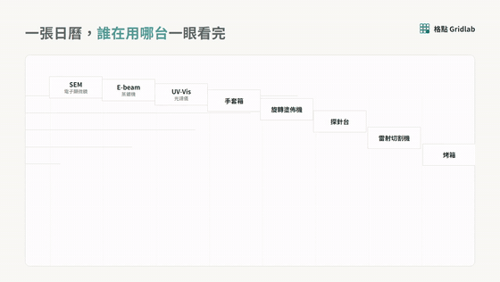
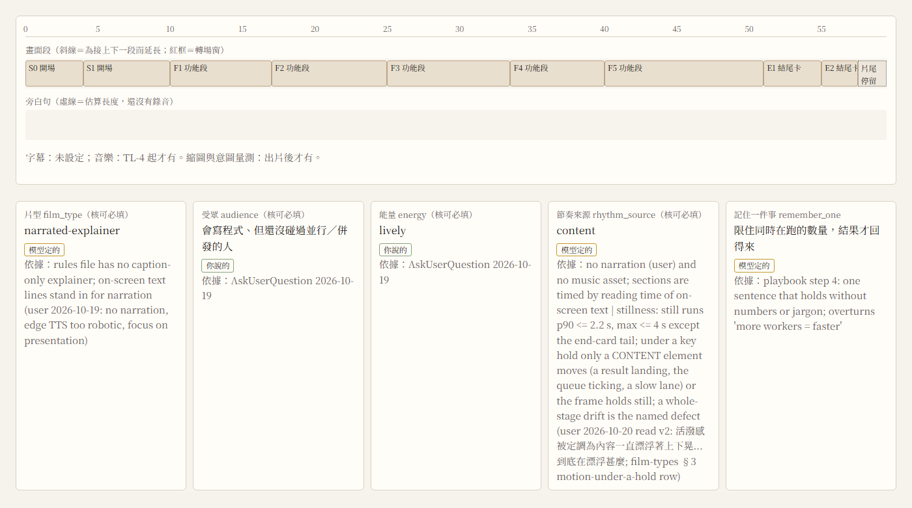
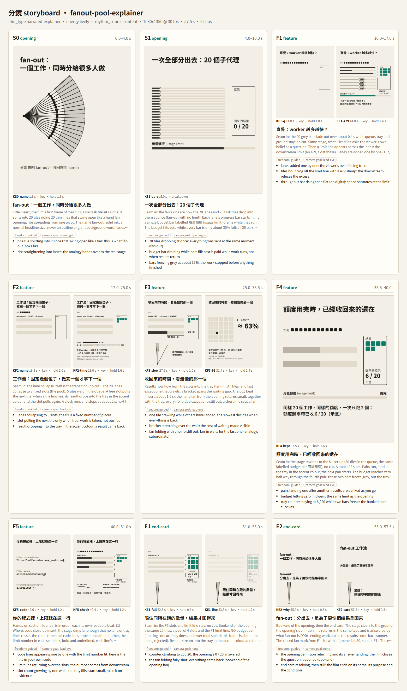
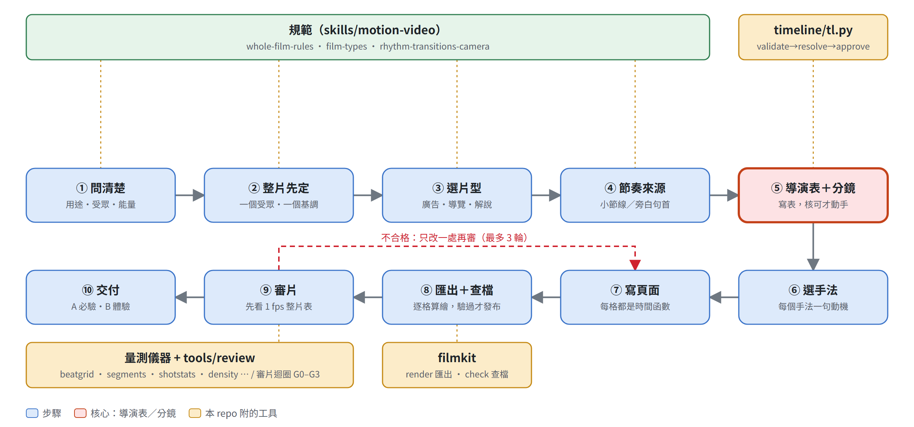
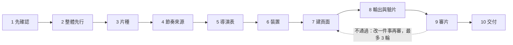

<div align="center">

# motion-video-kit

**用程式碼做整支影片：先寫一張「導演表」把受眾、基調、分段、轉場、運鏡全部定下來，再逐格算出每個畫面、輸出 MP4，最後用儀器量它有沒有照表做。**

一個 Claude Code skill（motion-video，附五份方法文件）＋ 導演表工具（timeline，驗證、換算時間、核准）＋ 渲染與驗片工具（filmkit）＋ 審片迴圈（review）＋ 剪輯路線（edit）＋ 29 支各自帶自我測試的量測儀器 ＋ 一支完整的範例片。

**繁體中文** · [English](README.en.md)

[](https://github.com/WizerdBaChe/motion-video-kit/releases/latest)
[](LICENSE)
[](LICENSE-DOCS)
[](AGENTS.md)
[](docs/DEVELOPER.md#環境)
[](docs/DEVELOPER.md#環境)

[看成品](#成品看得到什麼) · [核心：導演表](#核心導演表分鏡) · [用法](#用法) · [限制](#限制) · [開發者文件](docs/DEVELOPER.md) · [給 agent 的入口](AGENTS.md) · [版本紀錄](CHANGELOG.md)


<sub>上圖是用本 repo 的方法與工具渲染的宣傳片截段（動圖；完整 MP4 是 release 附件）。</sub>

</div>

## 它解決什麼

請 AI 做一支影片，常見的壞結果：

- **一開始就動手寫畫面**：沒先問這支片給誰看、要他看完做什麼、基調多熱，做出來每一段都很炫，合起來沒有重點。
- **「這段順不順」只靠感覺**：段落換在哪一拍、旁白和畫面對不對得上、鏡頭有沒有動，沒人量；要等人看過才知道錯。
- **改一輪忘一輪**：下一輪修改時，前一輪定好的東西被悄悄改回去。

這個 kit 把「想清楚」和「做出來」拆開，每一步留下可以檢查的紀錄：

| 階段 | 你得到的 | 怎麼守住 |
|---|---|---|
| **先確認** | 用途、片種、放映處、受眾、唯一要記住的一件事、能量（calm / lively / hype） | skill 規定這些要先問、先寫下來；沒人可問時寫成 `questions.md`，不憑空推定 |
| **導演表**（核心） | 一份 `film.timeline.json`：每一段的起點、時長、自由度、動機句、關鍵幀 | `tl.py` 驗格式與時間、換算成秒、核准後才動手建頁面 |
| **建頁面與輸出** | 每一格畫面都是時間的純函式的頁面，用 filmkit 逐格擷取、編碼、驗證，通過才發佈檔名 | `tools/filmkit/check.py` 對成品檔給五行結論與規則列（FK-R） |
| **量測與審片** | 29 支帶自我測試的儀器（節拍對齊、旁白鎖定、鏡頭、運動密度、產品數字真偽…）；四關審片 G0–G3，最多 3 輪 | 這 29 支各有 `--selftest`（已知為真、已知為假的合成輸入）；審片迴圈的拒絕規則有自我測試 |

## 成品看得到什麼

下面每一支都是用這套方法與工具做的完整影片截段，依用途分組。動圖是縮小版；完整 MP4 在 [release 頁面](https://github.com/WizerdBaChe/motion-video-kit/releases/latest)。
（影片內的畫面文字多為繁體中文；片中的產品與公司是虛構或作者自己的作品；沒有真人。宣傳片畫面內有虛構帳號與平台縮寫（IG / YT / TH）的示意徽章，沒有第三方標誌圖樣。）

<table>
<tr>
<td width="50%" valign="top">

**宣傳片（hype ad）：節拍切換、鏡頭推近**<br>
<sub>一支 30 秒的下載工具宣傳片：標題字、進度與頁面卡片依節拍換場。完整 MP4：release 附件 <code>showcase-hype-ad.mp4</code></sub>


</td>
<td width="50%" valign="top">

**產品介紹（product intro）：一個功能一個畫面**<br>
<sub>產品介紹片的一個段落：一個畫面只講一件事，轉場把上一個畫面的形狀接到下一個。完整 MP4：<code>showcase-product-intro.mp4</code></sub>



</td>
</tr>
<tr>
<td width="50%" valign="top">

**旁白說明動畫（narrated explainer）：用畫面把「並行」講清楚**<br>
<sub>範例片 fanout-pool-explainer（本 repo 附原始頁面，可自己重新渲染）。完整 MP4：<code>showcase-narrated-explainer.mp4</code></sub>


</td>
<td width="50%" valign="top">

**WebGL 3D 場景（webgl scene）**<br>
<sub>用 Three.js 在頁面裡做的 3D 場景，每一格仍由時間算出，所以可以逐格輸出。完整 MP4：<code>showcase-webgl-scene.mp4</code></sub>


</td>
</tr>
<tr>
<td colspan="2" valign="top">

**字的動態（text motion）：同一句字用不同動態語彙**<br>
<sub>把「動態的名字」逐個做成實作與描述，驗證名字和做出來的東西對得上。完整 MP4：<code>showcase-text-motion.mp4</code></sub>


</td>
</tr>
</table>

<sub>這些動圖由 <code>docs/assets/build_showcase.py</code> 從完整 MP4 裁切（命令見 <a href="docs/DEVELOPER.md#重新產生-readme-圖片">開發者文件</a>）。其中說明動畫可用本 repo 附的頁面與 filmkit 自行重新渲染；其餘四支的原始頁面不在本 repo，只提供成品。宣傳片與產品介紹的音軌已在公開版移除。</sub>

## 核心：導演表（分鏡）

整套方法的核心不是渲染器，也不是量測儀器，而是**導演表**：影片動手之前先寫好、並且核准的那一張表。



<sub>上圖是用本 repo 的 <code>tl.py</code>（驗證、換算時間、產生檢視頁）對隨附範例片產生的真實檢視頁。圖內標籤為繁體中文。</sub>

導演表裡每一段（section）要寫的東西，就是這支片的合約：



<sub>由 <code>docs/assets/build_core.py</code> 對範例片實際渲染關鍵幀、把導演表組成分鏡圖。圖內標籤為繁體中文與英文。</sub>

**為什麼它是核心：**

1. **它把「這支片要做什麼」從腦中拉出來，變成別人和程式都讀得到的東西。** 受眾、能量、節奏來源、記住的一件事，每一項標明是誰定的（使用者、模型或預設）和依據；格式不合的欄位，`tl.py validate` 會直接擋下。
2. **它是後面所有檢查的基準。** 段落的起點與時長，決定儀器去哪個時間點量「換段有沒有落在節拍上」；關鍵幀決定審片看哪幾張；動機句決定一個移動元素有沒有存在的理由（沒有動機句的元素就靜止或拿掉）。沒有這張表，這些量測就沒有東西可以對照。
3. **它讓多輪修改不退步。** 審片迴圈針對表裡的項目提出修改，並有明確的拒絕規則（review.py 的自我測試涵蓋）。
4. **它讓人只需要判斷一次。** 使用者看表、說「可以」，後面的建置、輸出、量測交給工具與 agent；回頭看的是表與量測結果，不是反覆看影片。

## 用法

### 交給你的 agent 安裝

把下面這段貼給 Claude Code（或其他能讀檔、跑 Python 的 agent）：

```text
請讀 https://github.com/WizerdBaChe/motion-video-kit/tree/v1.0.0 的 AGENTS.md（固定用 v1.0.0 這個版本，不要用 main），照它的步驟：
1. 先跑 verify/run_controls.py，把結果和 verify/controls_run.txt 對照後告訴我；
2. 列出 docs/BUILD-SPEC.md 裡要對應到我環境的設定（資料夾、相依套件），等我確認；
3. 確認後把 motion-video skill 與工具裝進我的 ~/.claude。
不要改任何檢查的判定；有不一致就回報給我。
```

### 裝好之後怎麼叫它

| 你說 | 會發生什麼 |
|---|---|
| 「做一支產品介紹片」「做宣傳片」「做旁白說明動畫」 | agent 先問用途、受眾、能量；寫導演表給你核准；再建頁面、輸出、量測、審片 |
| 「這支片的段落怎麼換、轉場怎麼做、運鏡怎麼走」 | 讀節奏、轉場與運鏡的規則文件，給有證據等級標示的建議 |
| 「幫我量這支片有沒有照節拍」 | 呼叫對應的量測儀器（節拍對齊、旁白鎖定、運動密度…） |

### 不裝 agent，自己看一次導演表

需要 Python 3.12 以上，不需要 API 金鑰。把整個範例片資料夾複製到別處（資料夾名必須維持 `fanout-pool-explainer`，等於它的 `film_id`），再對那份複製跑驗證：

```text
python -X utf8 reference-impl/tools/timeline/tl.py validate --static <複製出來的 fanout-pool-explainer 資料夾>
```

會看到 `0 blocking`（另有 1 項「要你看」與數項 info，不擋）。再把該資料夾 `film.timeline.json` 裡 `decisions.energy.value` 從 `lively` 改成 `frantic` 再跑一次，會出現 `1 blocking`、結束碼 2（值不在 calm / lively / hype 之內）。改回來即可。

### 跑完整驗收

```text
python -X utf8 verify/run_controls.py          # 約 4 分鐘；--full 另跑 filmkit 完整自我測試（約 10–20 分鐘）
```

每一列印出「應有值」與「實際值」，故意弄壞的版本必須讓值改變。結果記錄在 [`verify/controls_run.txt`](verify/controls_run.txt)。

## 運作流程



<sub>圖由 <a href="docs/assets/flow.build.mjs"><code>docs/assets/flow.build.mjs</code></a> 產生：每個節點對應 SKILL.md「Order of work」的一個步驟（對照表在 <a href="docs/DEVELOPER.md#readme-流程圖對照">開發者文件</a>），並附幾何自檢與故意畫壞的對照。</sub>

<details><summary>文字版（mermaid）</summary>



</details>

## 這版有什麼（v1.0.0）

首次公開，內容是：

- **skill**：motion-video（路由與十步順序）＋ 五份方法文件（整片規則、片種、節奏轉場運鏡、建置與輸出、證據與儀器），加元件層動態參數表。
- **導演表層**：`tools/timeline/`（`tl.py` validate / resolve / approve / view；201 項自我測試）。
- **渲染與驗片**：`tools/filmkit/`（`render.py`、`check.py`、`transform.py`、規則檔與 FK-R 規則列；smoke 45 項）。
- **審片迴圈**：`tools/review/`（G0–G3；43 項自我測試）。
- **剪輯路線**：`tools/edit/`（EDL / OTIO、素材出處紀錄；16 項控制）。
- **29 支量測儀器**，各自帶 `--selftest`（另有 5 支輔助或比較腳本沒有自我測試，見 [`docs/EVIDENCE.md`](docs/EVIDENCE.md)）。
- **範例片**：`films/fanout-pool-explainer/`，含導演表、頁面與字型。
- 驗收腳本 K1–K8，每一項印出正確版與故意弄壞版的兩個值。

## 你想要……就讀……

| 你想要 | 讀 |
|---|---|
| 知道哪些規則是程式擋的、哪些靠 agent 自律 | [`docs/EVIDENCE.md`](docs/EVIDENCE.md) 的 Enforcement map |
| 看驗收實際跑出什麼 | [`verify/controls_run.txt`](verify/controls_run.txt) |
| 改造成自己的版本、看結構圖 | [`docs/DEVELOPER.md`](docs/DEVELOPER.md)、[`docs/BUILD-SPEC.md`](docs/BUILD-SPEC.md) |
| 讓 agent 安裝 | [`AGENTS.md`](AGENTS.md) |
| 只讀不執行的 agent 入口 | [`llms.txt`](llms.txt) 的 Read-only route |
| 方法本身 | [`SKILL.md`](reference-impl/skills/motion-video/SKILL.md)、[整片規則](reference-impl/skills/motion-video/references/whole-film-rules.md)、[片種](reference-impl/skills/motion-video/references/film-types.md) |
| 導演表怎麼運作 | [`timeline-layer-design.md`](reference-impl/docs/timeline-layer-design.md) |

## 限制

- **儀器是篩子，不是評審**：量測儀器告訴你「換段有沒有落在節拍上」「畫面有沒有在動」；影片好不好看、有沒有打動人，沒有任何儀器判得了，要人看。哪些規則是程式強制、哪些只是流程規則，見 [`docs/EVIDENCE.md`](docs/EVIDENCE.md)。
- **防粗心，不防刻意繞路**：閘門擋得住漏填的欄位、格式錯誤、檔案壞掉、沒走驗證就發佈；擋不住一個刻意規避的 agent（導演表的「已核准」是檔案裡的欄位，沒有簽章）。
- **規則的證據有等級**：每條規則標明 user（使用者看片判斷）、measured（儀器在參考片上量到）、verified（盲測 A/B 移動了結果）或 unvalidated（量過但從未實測模仿）。不要把 unvalidated 的規則當成已證明的。
- **相依套件不少**：Python 3.12 加 numpy、scipy、matplotlib、opencv-python-headless、pillow、playwright（含 Chromium）、OpenTimelineIO，以及 ffmpeg；清單與授權見 [`THIRD_PARTY_NOTICES.md`](THIRD_PARTY_NOTICES.md)。剪輯路線的生成素材需要本機 ComfyUI，未安裝時對應的測試回報 skip。
- **公開版不含**：案例庫與外部影片的分析、模仿實驗輸出、廠商函式庫壓縮檔（GSAP、three.js 等需自行取得）、原環境的作品目錄。被引用但未附的路徑列在 [`verify/unshipped_paths.txt`](verify/unshipped_paths.txt)。
- **只在 Windows 11 + Python 3.12 實測**；macOS / Linux 沒有跑過。完整的 filmkit 自我測試有幾項需要原環境的作品契約目錄，乾淨環境下會回報「無法判定」，數字與原環境不同。
- **成品影片的音軌**：公開的宣傳片與產品介紹 MP4 已移除音軌。
- 更多限制與人工驗收清單：[`docs/DEVELOPER.md`](docs/DEVELOPER.md#限制)。

## 作者

巴哲 BaChe · [GitHub](https://github.com/WizerdBaChe) · [網站](https://wizerdbache.com/) · [YouTube](https://www.youtube.com/@wizerdbache) · [Threads](https://www.threads.com/@wizerd.bache)

## 授權

程式碼 [MIT](LICENSE)；文件與圖片 [CC BY 4.0](LICENSE-DOCS)；第三方材料見 [`THIRD_PARTY_NOTICES.md`](THIRD_PARTY_NOTICES.md)。
