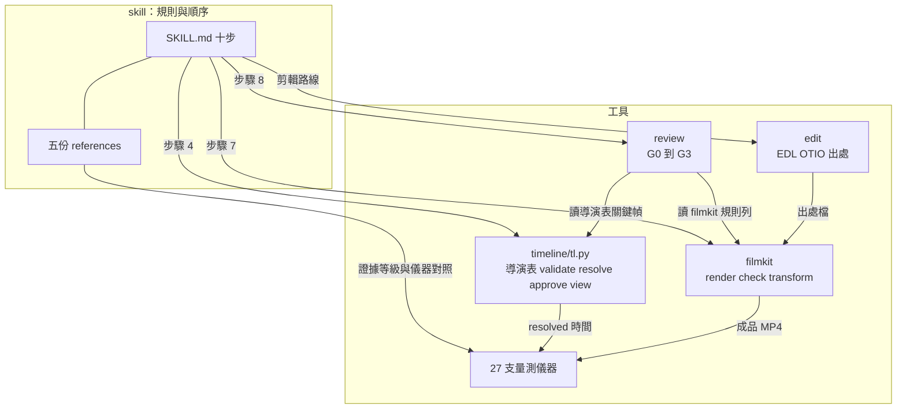
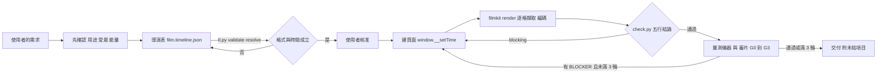

# 開發者文件（DEVELOPER）

給想改造、擴充或驗證這個 kit 的人。要快速了解它做什麼，看 [`README.md`](../README.md)；給 agent 的入口是 [`AGENTS.md`](../AGENTS.md) 與 [`llms.txt`](../llms.txt)；規格見 [`BUILD-SPEC.md`](BUILD-SPEC.md)，證據與強制方式見 [`EVIDENCE.md`](EVIDENCE.md)。

## 結構樹

```text
motion-video-kit/
├── README.md · README.en.md · AGENTS.md · llms.txt · CHANGELOG.md
├── LICENSE (MIT) · LICENSE-DOCS (CC BY 4.0) · THIRD_PARTY_NOTICES.md
├── docs/
│  ├── DEVELOPER.md · BUILD-SPEC.md · EVIDENCE.md
│  └── assets/                     README 圖片與重新產生它們的腳本
│     ├── build_assets.py          總入口：--only flow|core|showcase
│     ├── flow.build.mjs           流程圖（SVG，含幾何自檢與 --selftest）
│     ├── build_core.py            導演表檢視頁與分鏡圖
│     ├── build_showcase.py        成品動圖（從 release 的 MP4 裁切）
│     └── flow.*.svg|png · core-*.png · showcase-*.gif
├── verify/
│  ├── run_controls.py             K1–K8 雙側控制
│  ├── reference-impl.sha256       reference-impl/ 逐檔 sha256
│  ├── controls_run.txt            記錄下來的驗收輸出
│  ├── fresh_clone_run.txt         空 HOME 下乾淨 clone 的執行紀錄
│  ├── requirements.txt · unshipped_paths.txt
└── reference-impl/                原環境的位元組副本（-text，不要手改）
   ├── skills/motion-video/        SKILL.md + references/ 五份方法文件
   ├── skills/motion-design/local/element-motion-params.md
   ├── tools/
   │  ├── timeline/                tl.py、_tl/、schema、components/、selftest
   │  ├── filmkit/                 render.py、check.py、transform.py、_fk/、selftest
   │  ├── review/                  review.py、selftest
   │  ├── edit/                    edit.py、edl.py、assets.py、adapters.py、comfy/
   │  ├── filmkit_rules.json · filmkit_rules_selftest.py
   │  └── <27 支量測儀器>.py        avsync beatgrid bgswitch blurdip camflow …（各有 --selftest）
   ├── docs/                       設計與製作文件（filmkit-psm、timeline-layer-*、edit-route-design …）
   └── films/fanout-pool-explainer/ 範例片：film.timeline.json、assets/、page/（含字型）
```

`reference-impl/` 內的路徑已用中性代號取代原環境的機器路徑（宣告的修改清單見 [`BUILD-SPEC.md`](BUILD-SPEC.md) §9）；手改它會讓 K1 的 sha256 對不上。要改請改原環境再重新產生。

## 元件圖



模組間的依賴方向：skill 文字指向工具；工具之間主要透過檔案溝通（導演表、`build/timeline.resolved.json`、`render.json`、各種 `*.json` 紀錄），少數儀器會直接 import 另一支（例如量測腳本引用 `beatgrid`、`phaselock`、`narrlock`）。圖中的箭頭是資料流向的概略，不是逐檔 import 的完整清單；精確的相依請看各檔開頭的 docstring。

## 工作流程圖



## README 流程圖對照

README 的流程圖由 [`assets/flow.build.mjs`](assets/flow.build.mjs) 產生；每個節點對應 `skills/motion-video/SKILL.md`「Order of work」的一個步驟（用 `node docs/assets/flow.build.mjs --mapping` 重印這張表）：

| 節點 | SKILL.md 步驟 | 規則或工具檔 |
|---|---|---|
| 1 Confirm | 步驟 0 | `whole-film-rules.md` §0 |
| 2 Whole film first | 步驟 1 | `whole-film-rules.md` §1 |
| 3 Film type | 步驟 2 | `film-types.md` |
| 4 Rhythm source | 步驟 3 | `rhythm-transitions-camera.md` §1 |
| 5 Director sheet + storyboard | 步驟 4 | `docs/timeline-layer-psm.md`；`tools/timeline/` |
| 6 Devices | 步驟 5 | `whole-film-rules.md` §2a |
| 7 Build the page | 步驟 6 | `build-and-export.md` §1 |
| 8 Export + check | 步驟 7 | `tools/filmkit/README.md` |
| 9 Review | 步驟 8 | `build-and-export.md` §3；`tools/review/README.md` |
| 10 Deliver | 步驟 9 | SKILL.md「Delivery shape」 |

圖中回到第 7 步的紅色虛線對應步驟 8 的「一次改一件事、最多 3 輪」。上方綠色帶是 `skills/motion-video/` 的規則文件，琥珀色卡片是本 repo 出貨的工具。

## 模組對照

| 你要找 | 在哪 | 入口與說明 |
|---|---|---|
| 導演表格式與時間驗證 | `tools/timeline/` | `tl.py`；README.md 列出所有命令；契約 `docs/timeline-layer-psm.md` |
| 渲染與成品檢查 | `tools/filmkit/` | `render.py`（逐格擷取、編碼、驗證、發佈）、`check.py`（五行結論）、`transform.py`；規則 `tools/filmkit_rules.json` |
| 審片迴圈 | `tools/review/` | `review.py new <film> G0|G1|G2|G3`；設計 `docs/agent-review-kbt-design.md` |
| 剪輯路線 | `tools/edit/` | `edit.py`、`edl.py`；設計 `docs/edit-route-design.md` |
| 節拍與段落對齊 | `tools/beatgrid.py`、`segments.py`、`phaselock.py`、`measure_product.py`、`narrlock.py` | 各檔開頭 docstring 說明問題、輸入、輸出 |
| 運動與鏡頭 | `tools/density.py`、`camflow.py`、`blurdip.py`、`flashwash.py`、`shotstats.py` | 同上 |
| 產品數字真偽 | `tools/fidelity.py` | 讀 `build/claims.json` |
| 影片整體比較 | `tools/compare.py`、`measure_arm.py`、`measure_showreel.py`、`measure_narrated.py` | 同上 |
| 方法文件 | `skills/motion-video/references/` | 路由表在 SKILL.md 開頭 |

## 環境

- **實測：** Windows 11、Python 3.12.7（需要 3.12 以上）、numpy 2.5.2、scipy 1.18.0、matplotlib 3.11.1、opencv-python-headless 4.12.0.88、pillow 12.3.0、playwright 1.62.0（`playwright install chromium`）、OpenTimelineIO 0.18.1、ffmpeg 在 PATH。
- 不需要 API 金鑰、不需要網路（控制項不連網）。
- `tools/timeline/` 只用標準庫；導演表的鎖檔是 Windows 的位元組鎖，Windows 優先。
- 渲染需要能開 Chromium（無頭）；WebGL 頁面在沒有 GPU 的機器上沒有測過。
- 剪輯路線的 ComfyUI 轉接器需要本機 ComfyUI 與模型檔；沒有時對應測試回報 skip。
- 字型：範例頁面內嵌 Noto Sans TC 與 IBM Plex Mono 子集（OFL）；README 圖片的版面使用機器上裝的中文字型，沒有時字形不同、內容相同。

## 怎麼驗證

```text
python -X utf8 verify/run_controls.py            # 約 4 分鐘；K1–K8
python -X utf8 verify/run_controls.py --full     # 另跑完整 filmkit selftest（10–20 分鐘）
python -X utf8 verify/run_controls.py --only K8  # 單一控制組
python -X utf8 verify/run_controls.py --write-sums   # reference-impl/ 有變時才用，重寫 sha256 清單
```

每列印出「應有值」與「實際值」；突變版必須讓實際值改變（K1-neg、K3-neg、K4-neg、K5-neg、K7-neg、K8-neg）。記錄下來的輸出：[`verify/controls_run.txt`](../verify/controls_run.txt)；乾淨 clone 的執行：[`verify/fresh_clone_run.txt`](../verify/fresh_clone_run.txt)。

## 刻意的設計

- **導演表是唯一的合約。** 後面的量測與審片都對它，不對口頭約定；格式不合的值在導演表階段就擋下，不留到渲染之後。
- **每一格是時間的純函式（`window.__setTime(t)`），不用計時器與 CSS transition。** 這讓逐格擷取可重現，也讓同一頁面能在任何時間點被截圖做關鍵幀比對。
- **渲染器先驗證、後發佈檔名。** 失敗時保留前一版並標為過時，不會把壞檔當成品。
- **每支儀器自帶合成的已知真假輸入。** 儀器的結論是否可信，先看它的 `--selftest` 能不能辨出已知為假的輸入。
- **審片的擋片依據只有四類。** 品味類的意見只能是「打磨」，不能擋；避免審片迴圈無限拉長（最多 3 輪）。
- **`reference-impl/` 是位元組副本。** 不手改；改動走宣告的修改清單與重新產生。

## 限制

- 儀器不評審美；規則的證據有等級，`unvalidated` 的規則不能當成已證明。
- 閘門防粗心，不防刻意規避；導演表的核准沒有簽章。
- 只在 Windows 11 + Python 3.12 實測；macOS / Linux 沒有跑。
- 完整 filmkit 自我測試有幾項需要原環境的作品契約目錄，乾淨環境下 skip；通過數與原環境不同。
- 剪輯路線的生成素材需要本機 ComfyUI；公開版只驗證 mock 轉接器與出處檢查。
- 五支成品影片只有說明動畫附原始頁面；其餘四支只提供成品。宣傳片與產品介紹的音軌已移除。
- 被引用但未附的原環境路徑（案例庫、實驗輸出、外部影片分析、廠商函式庫）列在 [`verify/unshipped_paths.txt`](../verify/unshipped_paths.txt)。
- 方法文件與設計文件內的證據行指向原環境的案例與回合紀錄，這些沒有隨附，所以那些行可讀但不能重跑。

## 人工驗收

不能用腳本靜態驗證的部分（要人看、要人跑）。

**A 必驗（依後果排序）**

1. 在你的機器上跑 `verify/run_controls.py`，確認每列 OK，並與 `verify/controls_run.txt` 的實際值對照。
2. 把範例片 `fanout-pool-explainer` 複製成資料夾名稱相同的位置，跑 `tl.py validate --static`，看到 0 blocking；再把 `decisions.energy.value` 改成 `frantic`，看到 1 blocking 與 exit 2。
3. 用 `docs/assets/build_showcase.py --render-explainer <資料夾>` 重新渲染範例片，用播放器看一遍：畫面逐格換、沒有卡住、尺寸 1080x1350、長度約 59.5 秒。
4. 打開 `docs/assets/core-director-sheet.png` 與 `core-storyboard.png`，確認時間軸、決定卡與九格分鏡的內容與 `film.timeline.json` 一致。
5. 跑 `python -X utf8 docs/assets/build_assets.py --only flow`，確認輸出 `text-fit: 0 overflow, positive control fired`，並打開 `flow.zh-TW.png` 確認箭頭沒有被擠壓、文字沒有溢出。
6. 把 `reference-impl/tools/phaselock.py` 的 `lock()` 改成永遠回「未鎖定」，跑它的 `--selftest`，確認它失敗（K7-neg 的手動版）。

**B 體驗**

- 讀 `skills/motion-video/SKILL.md` 的「Order of work」，想像你要做一支自己的片，看每一步問的問題是否合理。
- 看五個動圖，判斷它們是否「一眼看得出這支片在做什麼」；動圖是縮小版，完整影片品質看 release 的 MP4。
- 在自己的環境裝一遍（照 `AGENTS.md`），看 agent 是否在動手建頁面之前先問了用途、受眾與能量。

## 重新產生 README 圖片

所有 README 圖片都由 `docs/assets/` 的腳本產生，不手繪。需要 Python 3.12、`pip install playwright pillow`、`playwright install chromium`、Node.js（只用標準庫）、ffmpeg。

```text
python -X utf8 docs/assets/build_assets.py --only flow                    # flow.zh-TW.png / flow.en.png（含 --selftest 與文字溢出檢查）
python -X utf8 docs/assets/build_assets.py --only core                    # core-director-sheet.png、core-storyboard.png
python -X utf8 docs/assets/build_assets.py --only showcase --src <資料夾>  # 五個動圖，來源是 release 附件 showcase-*.mp4
python -X utf8 docs/assets/build_showcase.py --render-explainer <資料夾>  # 從隨附頁面重新渲染說明動畫 MP4
```

`--only core` 會用隨附的 `tl.py` 對範例片跑一遍驗證，再用隨附的頁面在關鍵時間點截圖。五個完整 MP4 是 release 附件（名稱 `showcase-hype-ad.mp4`、`showcase-product-intro.mp4`、`showcase-narrated-explainer.mp4`、`showcase-webgl-scene.mp4`、`showcase-text-motion.mp4`）；每個動圖的來源窗口、寬度與幀率寫在 `build_showcase.py` 的 `CLIPS`，單檔不超過 5 MB。
